<!--
  Profile README for github.com/yvursol
  Every image ships in a dark and a light version and follows the viewer's GitHub theme.
-->

<a href="https://itvursol.com">
  <picture>
    <source media="(prefers-color-scheme: dark)" srcset="assets/hero-dark.svg">
    <source media="(prefers-color-scheme: light)" srcset="assets/hero-light.svg">
    
  </picture>
</a>

 

 

<picture>
  <source media="(prefers-color-scheme: dark)" srcset="assets/whoami-dark.svg">
  <source media="(prefers-color-scheme: light)" srcset="assets/whoami-light.svg">
   Get-Engineer -Name yvursol | Format-List — Name: Yuri. Role: Systems Engineer. Focus: virtualization, databases, backup and recovery, monitoring. Platforms: VMware vSphere, Windows Server, FireBird, Oracle. Automates: PowerShell, Python, batch. Monitors: Zabbix, Grafana. Learning: Linux, Docker, Ansible, German. Speaks: Russian, German, English, Serbian. Motto: a backup only counts if it can be restored." src="assets/whoami-dark.svg" width="100%">
</picture>

## ⚡ By the numbers

<picture>
  <source media="(prefers-color-scheme: dark)" srcset="assets/stats-dark.svg">
  <source media="(prefers-color-scheme: light)" srcset="assets/stats-light.svg">
  
</picture>

## 🧰 Toolbox

<picture>
  <source media="(prefers-color-scheme: dark)" srcset="assets/stack-dark.svg">
  <source media="(prefers-color-scheme: light)" srcset="assets/stack-light.svg">
  
</picture>

## 🚀 Featured work

  <a href="https://github.com/yvursol/Backup-FireBird-und-Oracle">
    <picture>
      <source media="(prefers-color-scheme: dark)" srcset="assets/card-backup-dark.svg">
      <source media="(prefers-color-scheme: light)" srcset="assets/card-backup-light.svg">
      
    </picture>
  </a>
  <a href="https://itvursol.com">
    <picture>
      <source media="(prefers-color-scheme: dark)" srcset="assets/card-site-dark.svg">
      <source media="(prefers-color-scheme: light)" srcset="assets/card-site-light.svg">
      
    </picture>
  </a>

## 🔭 Right now

- 🛠️ **Day to day** — VMware, Windows Server, FireBird and Oracle, plus the scripts that make them boring
- 📦 **Building** — [Backup-FireBird-und-Oracle](https://github.com/yvursol/Backup-FireBird-und-Oracle): test restores, encryption, offsite copies, a morning check
- 🌱 **Learning** — Linux, Docker and Ansible · German, on the way to B1
- 💬 **Ask me about** — VMware snapshots and exports, FireBird `gbak`, Oracle Data Pump, why you should test your restores
- 📷 **Off duty** — systems thinking, film photography and pet rats

## 🐍 Contributions

<picture>
  <source media="(prefers-color-scheme: dark)" srcset="https://raw.githubusercontent.com/yvursol/yvursol/output/snake-dark.svg">
  <source media="(prefers-color-scheme: light)" srcset="https://raw.githubusercontent.com/yvursol/yvursol/output/snake-light.svg">
  
</picture>

 

<picture>
  <source media="(prefers-color-scheme: dark)" srcset="assets/footer-dark.svg">
  <source media="(prefers-color-scheme: light)" srcset="assets/footer-light.svg">
  
</picture>
